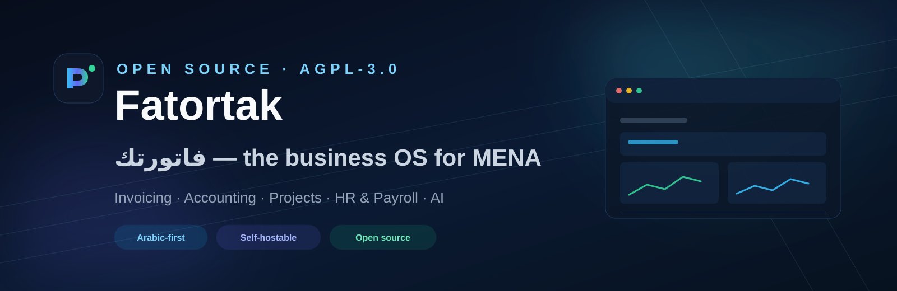
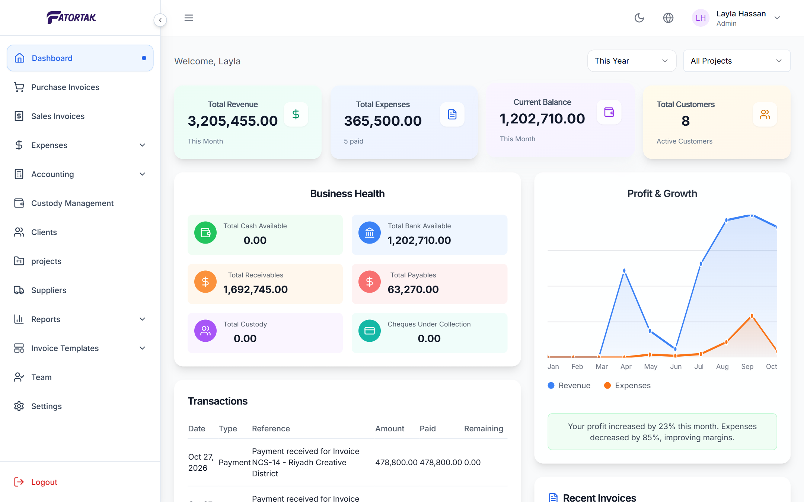
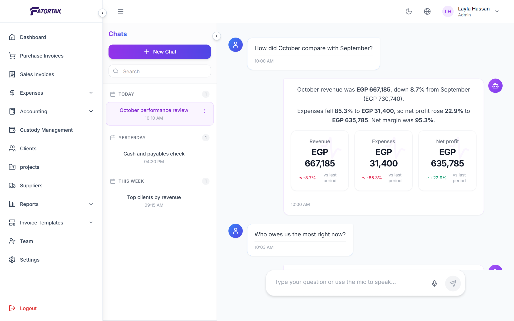
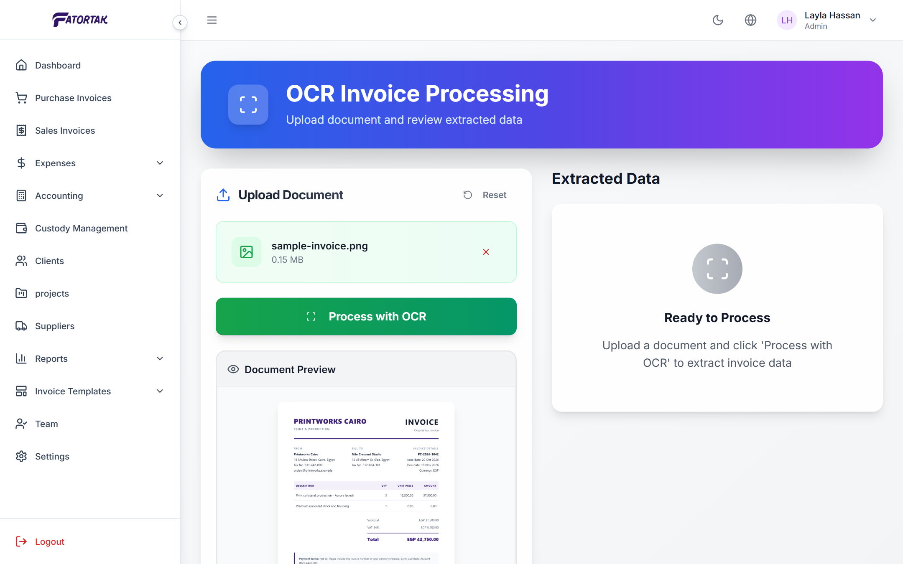
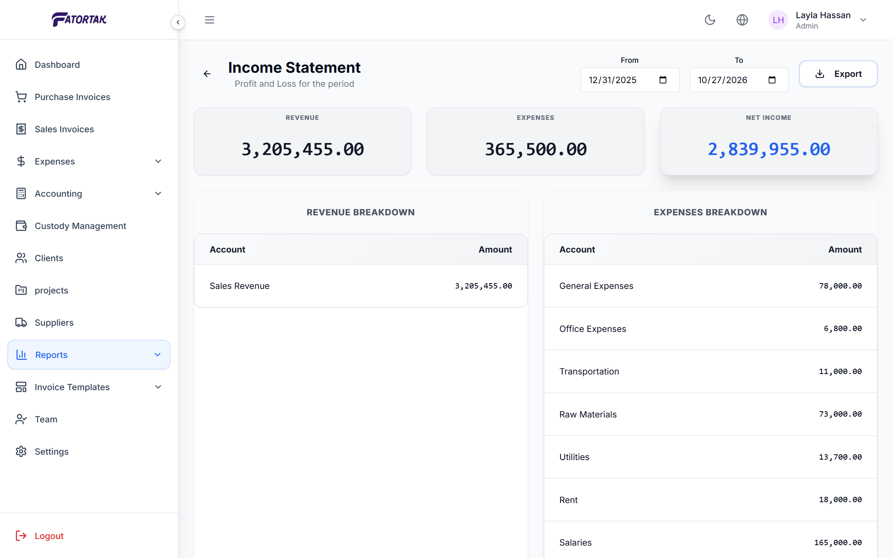
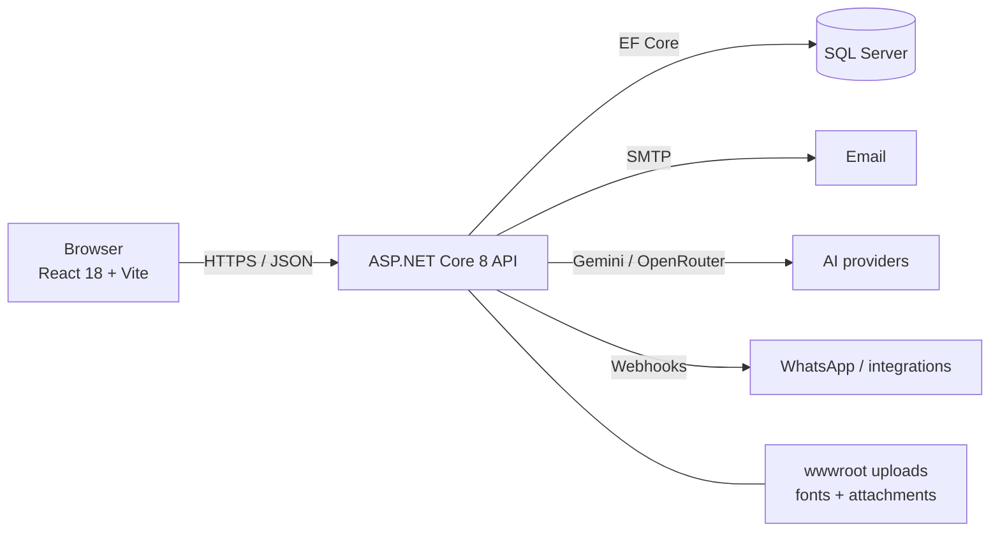

<p align="center">
  
</p>

<h1 align="center">Fatortak · فاتورتك</h1>

<p align="center">
  <strong>Invoicing, accounting, HR and projects for MENA businesses — Arabic-first, open source, self-hostable.</strong>
</p>

<p align="center">
  <a href="#-quickstart">Quickstart</a> ·
  <a href="https://fatortak.rabbeh.com/">Website</a> ·
  <a href="docs/self-hosting.md">Self-hosting</a> ·
  <a href="CONTRIBUTING.md">Contributing</a> ·
  <a href="docs/roadmap.md">Roadmap</a> ·
  <a href="#-commercial-support">Commercial support</a>
</p>

<p align="center">
  
  
  
  
  
  
</p>

---

> **Project status: alpha.** Fatortak is a real, working product used by businesses, but the open-source edition is in its first public release. Expect rough edges, missing tests and breaking changes before `v1.0`. Read [SECURITY.md](SECURITY.md) before exposing an instance to the internet.

## Why Fatortak?

Most accounting platforms are built for the US or Europe first. Fatortak is built for how businesses actually work in the Middle East and North Africa:

- **Arabic-first, not translated later.** Full RTL layouts, Arabic invoices, Arabic PDF fonts and a bilingual UI.
- **One system, not five.** Sales, purchases, inventory, double-entry accounting, projects, payroll and attendance share the same database.
- **WhatsApp-native customer flow.** Send invoices and payment reminders the way your customers already communicate.
- **AI that reads your invoices.** Scan a supplier invoice with OCR and turn it into a draft purchase invoice.
- **Own your data.** Self-host the whole stack with Docker. No per-invoice tax, no vendor lock-in.
- **Open source.** AGPL-3.0. Audit it, extend it, integrate it, or run it on your own servers.

## Product tour

Fatortak is a real application, not a landing-page mockup. The screens below are captures of the running application with demo data:

<p align="center">
  
  
</p>
<p align="center">
  <sub><strong>Dashboard</strong> — revenue, expenses, cash and receivables in one view.</sub>
  &nbsp;&nbsp;&nbsp;
  <sub><strong>AI assistant</strong> — ask your ledger a question and get the figures back.</sub>
</p>

<p align="center">
  
  
</p>
<p align="center">
  <sub><strong>OCR invoice</strong> — upload, preview and review before creating the invoice.</sub>
  &nbsp;&nbsp;&nbsp;
  <sub><strong>Income statement</strong> — close the month with a real ledger report.</sub>
</p>

The [landing page](https://fatortak.rabbeh.com/) has an interactive 3D tour of these screens, including the AI chat and OCR flows.

<p align="center">
  
</p>

Every module writes to the same ledger. Project revenue, purchases, expenses and payroll can be linked to a project, so project margin is a ledger number rather than a separate spreadsheet.

A public demo tenant is still on the launch checklist. Until then, the fastest way to see the interface is the Docker quickstart below.

## What's inside

| Module | Highlights |
| --- | --- |
| **Sales & invoicing** | Cash and credit invoices, VAT, discounts, installments, partial payments, 6 invoice templates, PDF export, public invoice links, email/WhatsApp delivery |
| **Purchases & suppliers** | Purchase invoices, supplier statements, AP aging, expense tracking with attachments |
| **Accounting** | Chart of accounts, journal entries, double-entry posting, trial balance, general ledger, income statement, balance sheet, cash-flow statement, customer/vendor statements, sales reports |
| **Stakeholders** | Shareholders, partners and investors, ownership %, capital and loan balances, contributions, dividends, loans, withdrawals, ledger postings and statements |
| **Installation insights** | Self-hosted view of registered users, online sessions (last 5 minutes) and stored record counts |
| **Projects** | Contracts, project lines, budgets, cost breakdown, profitability per project, link invoices and expenses to projects |
| **Inventory** | Items, categories, purchase/selling prices, stock quantities, images |
| **HR & payroll** | Employees, departments, daily/monthly attendance, work settings, vacations, payroll runs |
| **Treasury** | Cheques, custody accounts, transactions, transfers, branches |
| **AI** | Natural-language assistant with charts, invoice OCR import |
| **Platform** | Multi-tenant companies, role-based access, subscription quotas, notifications, Arabic/English UI, dark mode, Swagger API |

## Architecture



- **Frontend:** React 18, TypeScript, Vite, Tailwind CSS, shadcn/ui, React Query, i18next (AR/EN + RTL)
- **Backend:** ASP.NET Core 8 Web API, Entity Framework Core 8, SQL Server, JWT auth, multi-tenancy middleware
- **AI:** Google Gemini + OpenRouter (configurable), OCR for supplier invoices
- **Deployment:** Docker Compose (API + web + SQL Server) or any reverse proxy

More detail: [docs/architecture.md](docs/architecture.md).

## 🚀 Quickstart

### Prerequisites

- [.NET 8 SDK](https://dotnet.microsoft.com/download/dotnet/8.0)
- [Node.js 20+](https://nodejs.org/) and npm
- SQL Server 2019+ (Express or Developer edition is fine)
- Optional: Docker Desktop

### 1. Clone

```bash
git clone https://github.com/Ahmed-Nasser99/Fatortak_Software.git
cd Fatortak_Software
```

### 2. Configure the API

```bash
cd fatortak_backend/fatortak
cp appsettings.example.json appsettings.json
```

Edit `appsettings.json`:

```jsonc
{
  "ConnectionStrings": {
    "DefaultConnection": "Server=localhost;Database=Fatortak;Trusted_Connection=True;TrustServerCertificate=True;"
  },
  "Jwt": { "Key": "generate-a-random-64-char-secret" },
  "SeedAdmin": {
    "Email": "admin@example.com",
    "UserName": "admin",
    "Password": "choose-a-strong-password"
  }
}
```

> `SeedAdmin:Password` is required to create the first system administrator. The app never falls back to a default password.

### 3. Run the API

```bash
dotnet restore
dotnet run
```

The API starts on `http://localhost:5002`; Swagger is at `http://localhost:5002/swagger`.
Migrations are applied automatically on startup.

### 4. Run the web app

```bash
cd ../../fatortak_frontend
cp .env.example .env
npm install
npm run dev
```

Open `http://localhost:8080` and sign in with the admin account you configured.

### 5. Or run everything with Docker

```bash
cp .env.docker.example .env
docker compose up --build
```

- Web: `http://localhost:3000`
- API: `http://localhost:5000`
- SQL Server: `localhost:1433`

See [docs/self-hosting.md](docs/self-hosting.md) for production notes, backups and reverse-proxy setup.

## Configuration

| Variable | Purpose |
| --- | --- |
| `ConnectionStrings__DefaultConnection` | SQL Server connection string |
| `Jwt__Key` | JWT signing key (32+ random characters) |
| `SeedAdmin__Email` / `SeedAdmin__UserName` / `SeedAdmin__Password` | First system administrator |
| `EmailSetting__Host` / `__Email` / `__Password` | SMTP for invoices and password resets |
| `GeminiApiKey` | Google Gemini key for the assistant and OCR |
| `OpenRouterApiKey` | Optional OpenRouter fallback |
| `VITE_API_URL` | Frontend build-time API URL |
| `Deployment__Mode` | `SelfHosted` or `MultiTenant`; self-hosted bypasses tenant/subscription limits |
| `SelfHosted__AllowRegistration` | Allow new users to join an existing self-hosted installation |
| `App__FrontendBaseUrl` | Public web URL used in password-reset links and public invoice links |
| `Cors__AllowedOrigins__0` | Allowed browser origin for the API |

Self-hosted installations use a single installation tenant, unlimited users/invoices, and an **Installation insights** page for registered users, online sessions and record counts. Set `Deployment__Mode=SelfHosted`; the Docker Compose file does this by default.

Never commit `appsettings.json` or `.env` files. Use environment variables or .NET user-secrets in production.

## Roadmap

See [docs/roadmap.md](docs/roadmap.md). Highlights:

- [x] Docker Compose + one-command self-hosting
- [ ] Demo dataset and seeded demo tenant
- [ ] Integration tests for invoicing and accounting posting
- [ ] E-invoicing integrations (Egypt ETA, Saudi ZATCA) — research
- [ ] Payment gateway (Paymob / Stripe) for subscriptions
- [ ] Bank feeds and reconciliation
- [ ] Public REST API docs and webhooks
- [ ] Security audit before `v1.0`

## Contributing

Contributions are welcome — code, docs, translations, bug reports and design.

1. Read [CONTRIBUTING.md](CONTRIBUTING.md).
2. Pick an issue labeled [`good first issue`](https://github.com/Ahmed-Nasser99/Fatortak_Software/labels/good%20first%20issue).
3. Join the discussion in [GitHub Discussions](https://github.com/Ahmed-Nasser99/Fatortak_Software/discussions).
4. Follow the [Code of Conduct](CODE_OF_CONDUCT.md).

Great places to start:

- Add tests around invoice totals, VAT and installment calculations.
- Improve Arabic translations and RTL polish.
- Add a Docker Compose stack and a demo dataset.
- Write a provider integration (email, WhatsApp, payments).
- Improve accessibility and keyboard navigation.

## 💼 Commercial support

Fatortak is **open core**. The community edition is free forever under AGPL-3.0. For companies that need more:

- **Fatortak Cloud** — managed hosting, automatic backups, updates and support.
- **Commercial license** — use Fatortak in closed-source products or offer it as a hosted service without AGPL obligations.
- **Priority support & implementation** — migration, data import, custom modules and training.

Contact: [info@fatortak.net](mailto:info@fatortak.net) · [fatortak.net](https://fatortak.net)

See [LICENSING.md](LICENSING.md) for details.

## License

Copyright © 2025-2026 Fatortak.

Licensed under the [GNU Affero General Public License v3.0](LICENSE). If AGPL does not fit your use case, a [commercial license](LICENSING.md) is available.

## Security

Please do not open public issues for security vulnerabilities. See [SECURITY.md](SECURITY.md).

---

<p align="center">
  Built in Egypt 🇪🇬 for MENA businesses · <a href="https://github.com/Ahmed-Nasser99/Fatortak_Software">Star the repo</a> if Fatortak saves you time.
</p>
