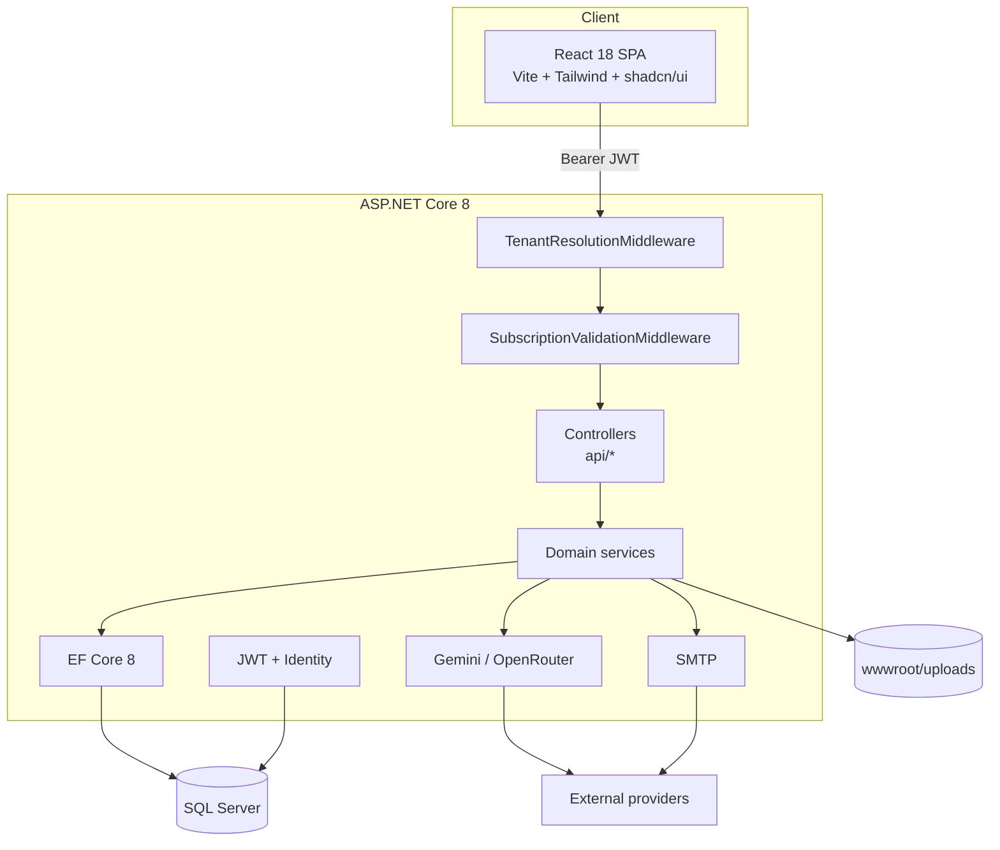
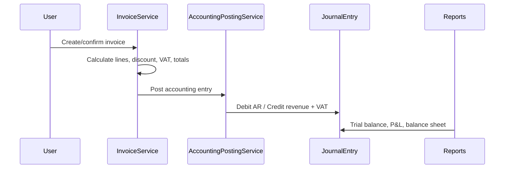

# Architecture

Fatortak is a multi-tenant business management system. One deployment serves many companies; every business record is scoped to a tenant.

## High-level diagram



## Layers

| Layer | Location | Responsibility |
| --- | --- | --- |
| SPA | `fatortak_frontend/src` | UI, routing, forms, i18n/RTL, API client |
| Controllers | `fatortak_backend/fatortak/Controllers` | HTTP surface, validation, authorization attributes |
| Services | `.../Services` | Business logic, accounting posting, reporting, AI |
| Data | `.../Context`, `.../Entities`, `.../FluentApiConfiguration` | EF Core model and SQL Server mappings |
| Middleware | `.../Middlewares` | Tenant resolution and subscription/quota enforcement |
| Seeding | `.../Seeding` | Initial admin, chart of accounts, invoice numbers |

## Multi-tenancy

- `Tenant` represents a company/workspace.
- Entities that belong to a tenant implement `ITenantEntity` and carry a `TenantId`.
- `TenantResolutionMiddleware` resolves the active tenant from the authenticated user's claims/context.
- `ApplicationDbContext` applies global query filters so a company cannot read another company's rows through normal queries.
- Users can belong to more than one tenant and switch the active company.

When adding a tenant-scoped entity:

1. Implement `ITenantEntity`.
2. Configure the relationship and index in `FluentApiConfiguration`.
3. Add the global query filter in `ApplicationDbContext`.
4. Add a migration.
5. Add a test proving tenant isolation.

## Authentication and authorization

- ASP.NET Core Identity stores users and password hashes.
- JWT bearer tokens are issued by `TokenService`.
- Roles include `SysAdmin`, company admin and employee-level roles.
- Controllers use `[Authorize]` and role attributes; services still enforce ownership checks.
- Password reset tokens use ASP.NET Data Protection keys persisted under `App_Data/Keys`.

## Accounting flow



Invoices, expenses, payments, cheques and custody movements create journal entries. Reports read from the ledger rather than recalculating from invoices, which keeps the books consistent.

## AI

- `AiQueryController` + `ChatService` power the natural-language assistant.
- `GeminiService` handles chat, visualizations and invoice OCR.
- The API key is read from configuration. Never expose it to the browser.
- AI output is advisory. Financial postings are always validated by deterministic code.

## Frontend structure

```
src/
  components/        reusable UI, modals, tables, invoice templates
  pages/             route-level screens (dashboard, invoices, reports, HR)
  hooks/             React Query data hooks
  services/          typed API clients
  contexts/          auth, language, theme
  integrations/      optional Supabase client
  types/             shared TypeScript types
```

The SPA is a static build. It talks to the API using `VITE_API_URL` and stores the JWT client-side. Serve it from Nginx, Caddy, Cloudflare Pages or any static host.

## Deployment topology

For production, use at least:

- one reverse proxy with TLS (Caddy/Nginx/Traefik)
- one API container (scale horizontally behind a load balancer if needed)
- one SQL Server instance with backups
- object storage or a persistent volume for `wwwroot/uploads`
- a secret manager for JWT, database, SMTP and AI keys

The API is stateless except for uploaded files and Data Protection keys. If you run more than one replica, share the uploads volume and persist/synchronize the Data Protection key ring.

## Known limitations

- No background job queue yet; reminders run as hosted services inside the API.
- No public API versioning or webhook system yet.
- Test coverage is thin, especially around accounting edge cases.
- The default CORS policy is permissive and must be restricted for production.
- SQL Server is the only supported database.

These are tracked in [roadmap.md](roadmap.md).
